# Manual de Uso — Sistema FRI (FRITransp)

Sistema web de gestão operacional da **Tóliman Transportes**: motoristas, monitoramento de operações de container, pátio, cadastros, vistoria, lacres, relatórios, HelpDesk e controle de versões.

> As telas deste manual foram capturadas no ambiente de produção. Campos e indicadores aparecem vazios ou zerados quando não havia registros no momento da captura.

## Sumário

1. [Acesso e tela inicial](#1-acesso-e-tela-inicial)
2. [Padrões de uso das telas](#2-padrões-de-uso-das-telas)
3. [Motorista](#3-motorista)
4. [Monitoramento](#4-monitoramento)
5. [Pátio](#5-pátio)
6. [Acesso](#6-acesso)
7. [Cadastros Operacionais](#7-cadastros-operacionais)
8. [Operacional](#8-operacional)
9. [Dashboards](#9-dashboards)
10. [Cliente](#10-cliente)
11. [Integração](#11-integração)
12. [Lacres](#12-lacres)
13. [Relatórios](#13-relatórios)
14. [Auditoria Registros](#14-auditoria-registros)
15. [HelpDesk](#15-helpdesk)
16. [Updates Version](#16-updates-version)
17. [Console](#17-console)
18. [Configurações](#18-configurações)
19. [Problemas conhecidos](#19-problemas-conhecidos)

---

## 1. Acesso e tela inicial

O sistema é acessado pelo navegador, na rede interna da empresa:

`http://10.10.0.10:9090/usermanager/login.aspx`

Informe seu usuário e senha. Depois do login, abre a tela inicial.

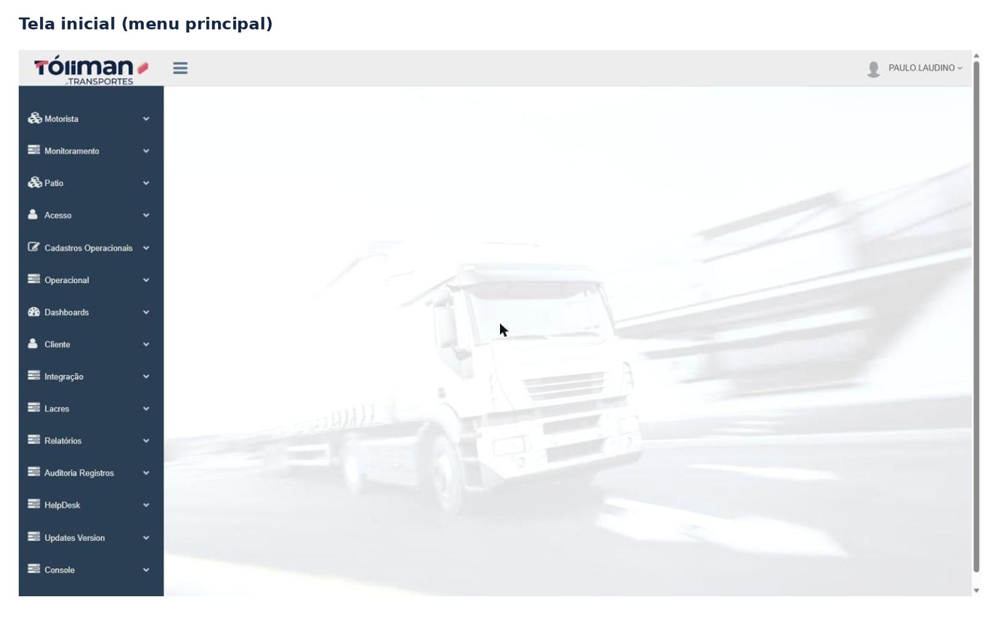

- **Menu lateral (à esquerda):** reúne todos os módulos. Clique em um módulo para abrir as telas dele.
- **Botão ☰ (ao lado do logo):** recolhe ou expande o menu lateral.
- **Nome do usuário (canto superior direito):** abre as opções da sua conta, como **Meus dados**.

Módulos do menu: Motorista, Monitoramento, Pátio, Acesso, Cadastros Operacionais, Operacional, Dashboards, Cliente, Integração, Lacres, Relatórios, Auditoria Registros, HelpDesk, Updates Version e Console.

## 2. Padrões de uso das telas

Os comportamentos abaixo se repetem em quase todo o sistema:

- **Telas em painéis:** cada tela abre em um painel. Os painéis abertos antes ficam empilhados logo abaixo, então dá para ter várias telas abertas ao mesmo tempo.
- **Botões do cabeçalho do painel:** `+` cria um novo registro (quando disponível), `^` recolhe o painel, `⤢` maximiza e `×` fecha.
- **Busca por tipo:** muitas telas têm o seletor **Buscar por** (por exemplo, Nome, Booking, Login ou Código), um campo **Texto da busca** e o botão **Buscar**.
- **Botão azul ⟳ (atualizar):** aplica os filtros e recarrega os dados da tela.
- **Indicadores numéricos:** as telas de monitoramento mostram contadores (por exemplo, "Vistoria a Realizar") com o total de registros em cada situação.
- **Confirmar / Cancelar:** nas telas de cadastro, **Confirmar** (verde) grava o registro e **Cancelar** (vermelho) descarta a edição. Campos com `*` em vermelho são obrigatórios.
- **Ações na grade:** ✏️ edita o registro e 🗑️ exclui.

## 3. Motorista

### 3.1 Estufagem

Mostra as estufagens do motorista identificado pelo CPF.

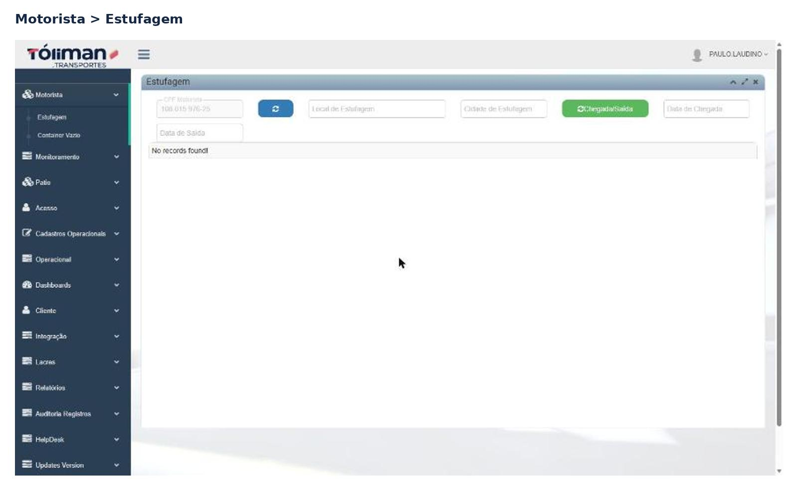

- **CPF Motorista:** preenchido com o CPF do usuário logado.
- **Local de Estufagem / Cidade de Estufagem:** local e cidade da operação.
- **Chegada/Saída (botão verde):** registra a chegada ou a saída do motorista no local de estufagem.
- **Data de Chegada / Data de Saída:** horários registrados.
- **⟳:** atualiza a lista.

### 3.2 Container Vazio

Lista os containers vazios vinculados ao motorista.

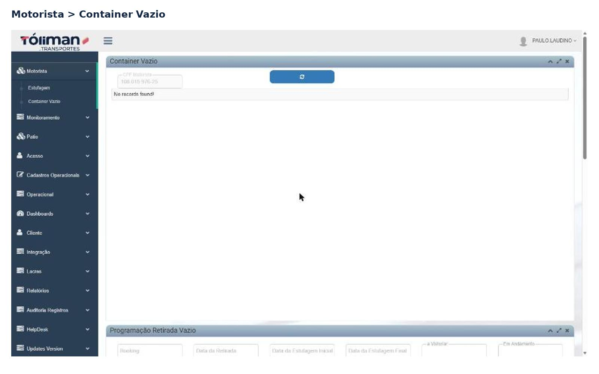

- **CPF Motorista:** identifica o motorista.
- **⟳:** atualiza a lista.

## 4. Monitoramento

### 4.1 Programação Retirada Vazio

Acompanha a programação de retirada de containers vazios e as vistorias ligadas a ela.

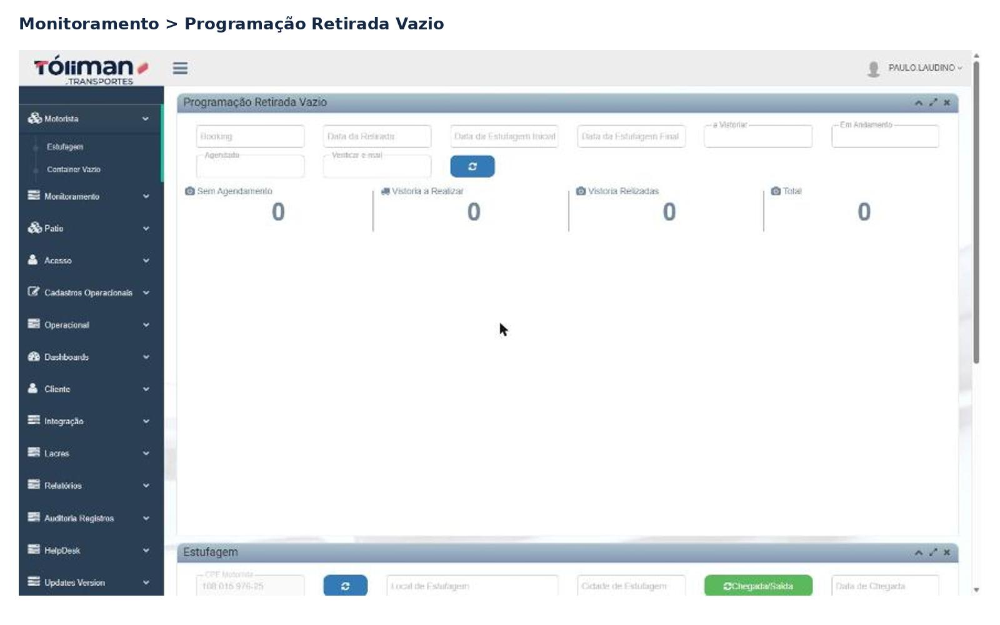

- **Filtros:** Booking, Data da Retirada, Data da Estufagem Inicial e Final, A Vistoriar, Em Andamento, Agendado e Verificar e-mail.
- **Indicadores:** Sem Agendamento, Vistoria a Realizar, Vistorias Realizadas e Total.

### 4.2 Retirada Vazio Motorista

Acompanha as retiradas de vazio por motorista.

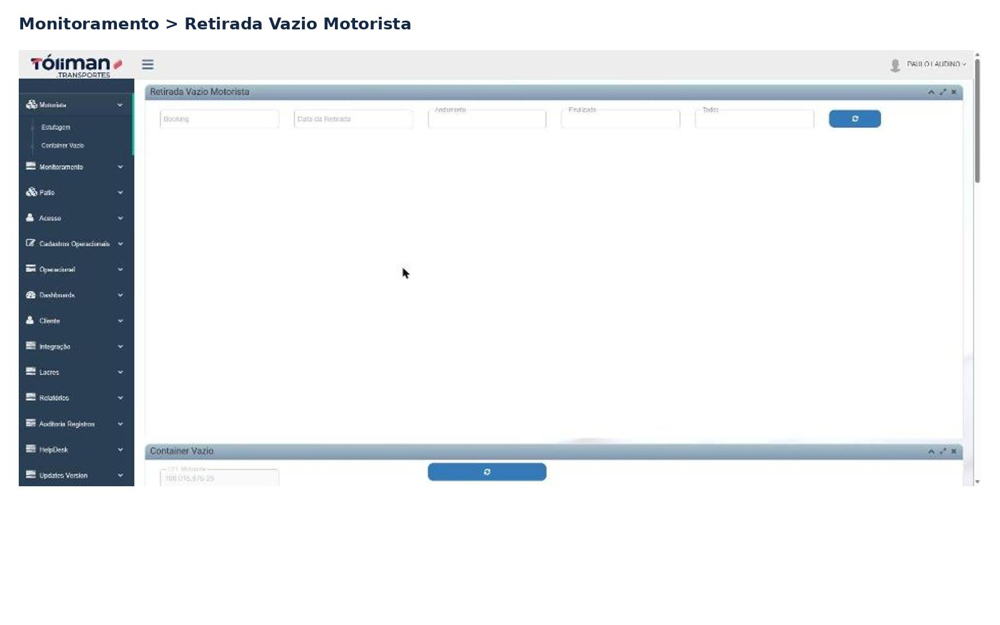

- **Filtros:** Booking, Data da Retirada e a situação (**Andamento**, **Finalizada** ou **Todos**).

### 4.3 Programação Diária

Painel da programação do dia, com a situação de cada etapa da operação.

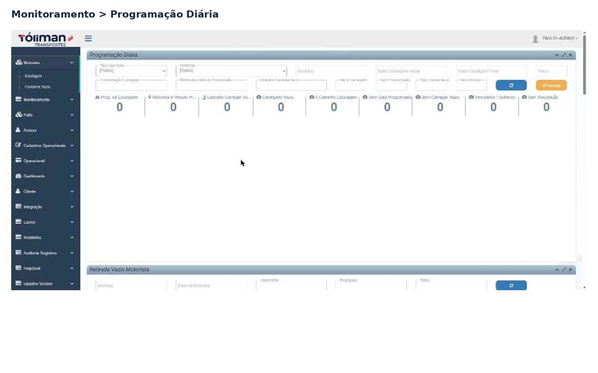

- **Filtros:** Tipo Operação, Motorista, Booking, Data Estufagem Inicial e Final, Placa e filtros de situação (Programação Estufagem, Motorista e Veículo Programado, Liberado Carregar Vazio, Vazio Carregado, Sem Programação, Sem Carregar Vazio, Sem Veículo).
- **Vistoria (botão laranja):** abre a vistoria dos registros.
- **Indicadores:** Prog. da Estufagem, Motorista e Veículo Programado, Liberado Carregar Vazio, Carregado Vazio, A Caminho Estufagem, Sem Data Programada, Sem Carregar Vazio, Vinculados / Solteiros e Sem Vinculação.

### 4.4 Estufagem Interior

Acompanha as estufagens realizadas no interior.

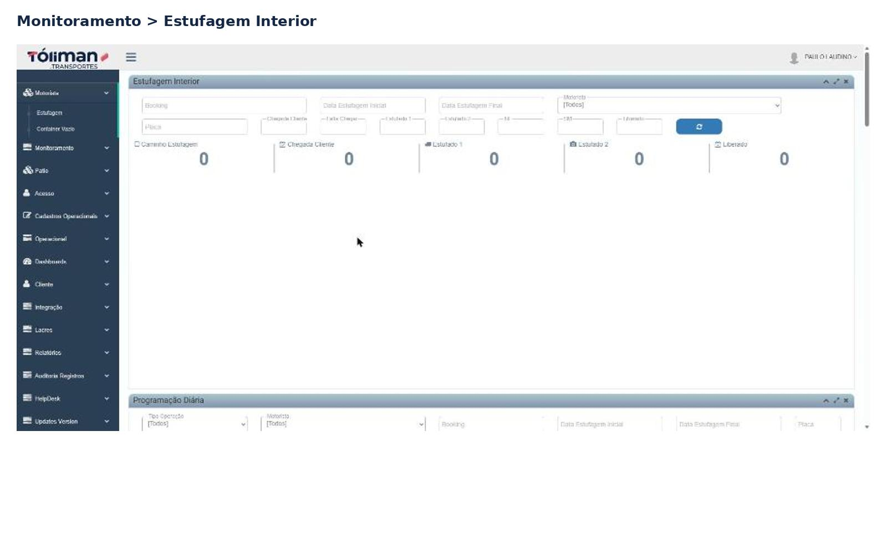

- **Filtros:** Booking, Data Estufagem Inicial e Final, Motorista, Placa e as etapas (Chegada Cliente, Falta Chegar, Estufado 1, Estufado 2, NF, DDI, Liberado).
- **Indicadores:** Caminho Estufagem, Chegada Cliente, Estufado 1, Estufado 2 e Liberado.

### 4.5 Entrega Cheio

Acompanha a entrega de containers cheios no terminal.

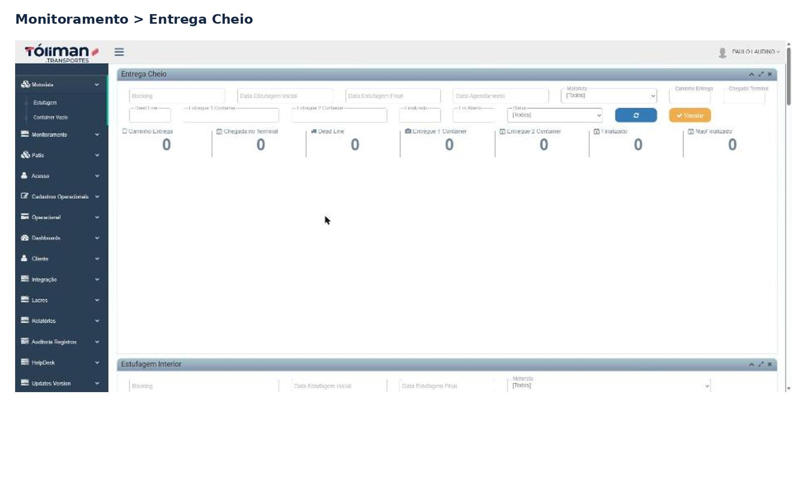

- **Filtros:** Booking, Data Estufagem Inicial e Final, Data Agendamento, Motorista, Caminho Entrega, Chegada Terminal, Dead Line, Entregue 1 Container, Entregue 2 Container, Finalizado, Fin. Atraso e Status.
- **Vistoria (botão laranja):** abre a vistoria.
- **Indicadores:** Caminho Entrega, Chegada no Terminal, Dead Line, Entregue 1 Container, Entregue 2 Container, Finalizado e Não Finalizado.

### 4.6 Entregas Interior

Mesma estrutura de **Entrega Cheio**, para as entregas do interior.

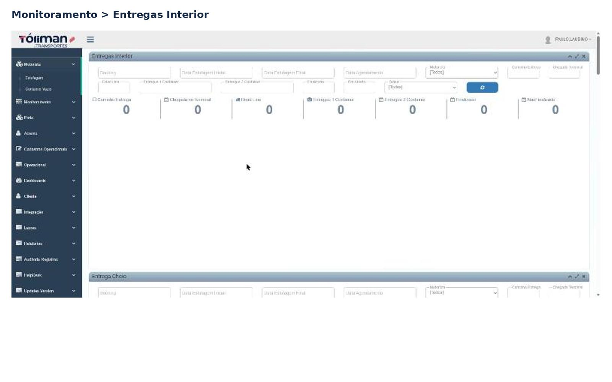

## 5. Pátio

### 5.1 Cancel. Carregamento

Localiza um carregamento para cancelá-lo.

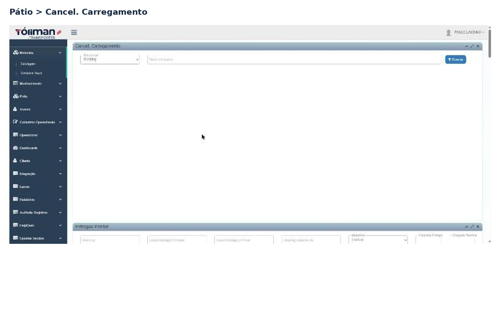

1. Em **Buscar por**, escolha o critério (por exemplo, Booking).
2. Digite o valor em **Texto da busca** e clique em **Buscar**.
3. Na lista de resultados, cancele o carregamento desejado.

### 5.2 Programação Carregamento

Mostra a programação de carregamento no pátio.

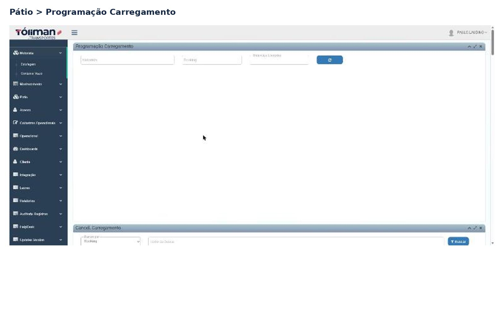

- **Filtros:** Motorista, Booking e Motoristas Liberados.
- **⟳:** atualiza a lista.

## 6. Acesso

### 6.1 Usuário

Consulta e cadastro dos usuários do sistema.

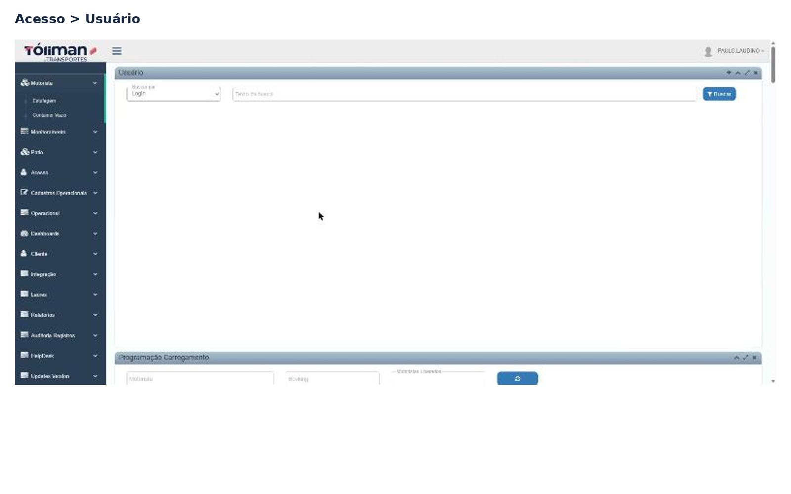

- **Buscar por** (por exemplo, Login) + **Texto da busca** + **Buscar**.
- **`+` no cabeçalho do painel:** cadastra um novo usuário.

### 6.2 Perfil de Acesso

Define os perfis que controlam o que cada usuário pode acessar.

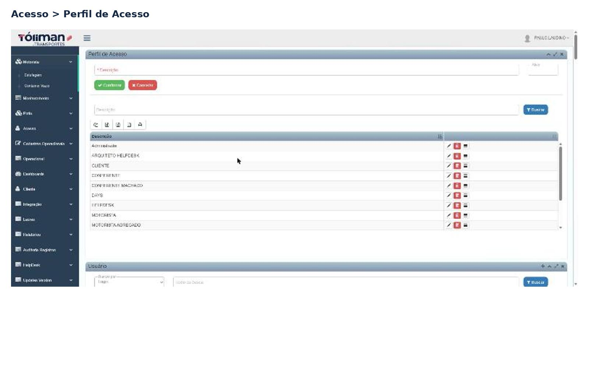

- **Novo perfil:** preencha **Descrição** (obrigatório), marque **Ativo** e clique em **Confirmar**.
- **Consulta:** filtre pela **Descrição** e clique em **Buscar**.
- **Botões acima da grade:** exportam ou imprimem a lista.
- **Ações por perfil:** ✏️ editar, 🗑️ excluir e ▤ permissões do perfil.
- Exemplos de perfis existentes: Administrador, Arquiteto HelpDesk, Cliente, Conferente, HelpDesk, Motorista e Motorista Agregado.

## 7. Cadastros Operacionais

### 7.1 Grupo de Clientes

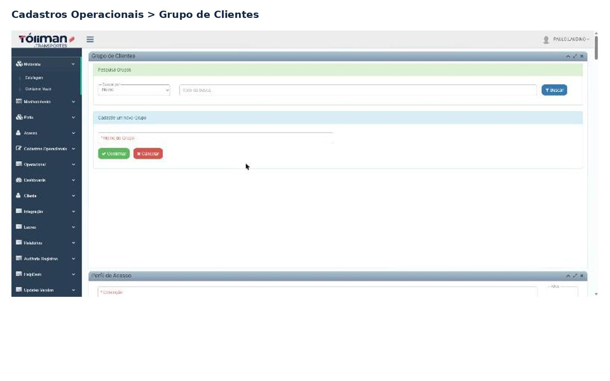

- **Pesquisa Grupos:** Buscar por (Nome) + Texto da busca + **Buscar**.
- **Cadastre um novo Grupo:** informe o **Nome do Grupo** e clique em **Confirmar**.

### 7.2 Eventos Estufagem

Cadastro dos eventos que podem ocorrer durante a estufagem. Use o `+` do cabeçalho para incluir um evento.

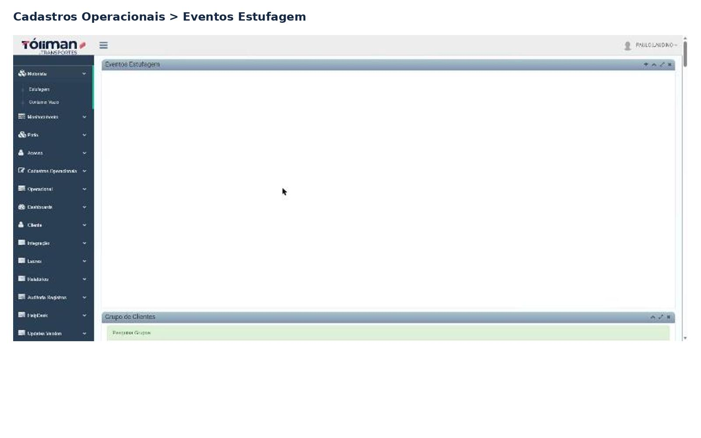

### 7.3 Procedimentos

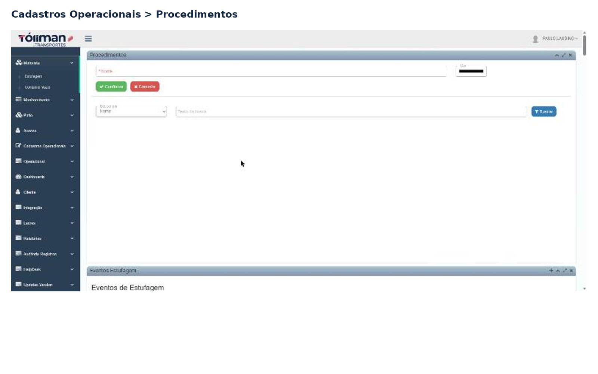

- **Novo procedimento:** informe o **Nome** (obrigatório), escolha a **Cor** e clique em **Confirmar**.
- **Consulta:** Buscar por (Nome) + Texto da busca + **Buscar**.

### 7.4 Status Entrega Cheio

Cadastro dos status usados em **Monitoramento > Entrega Cheio**. Funciona igual a Procedimentos: **Nome**, **Cor** e **Confirmar**.

### 7.5 Tipos Eventos Motoristas/Veículos

Cadastro dos tipos de evento que afetam a disponibilidade de motoristas e veículos.

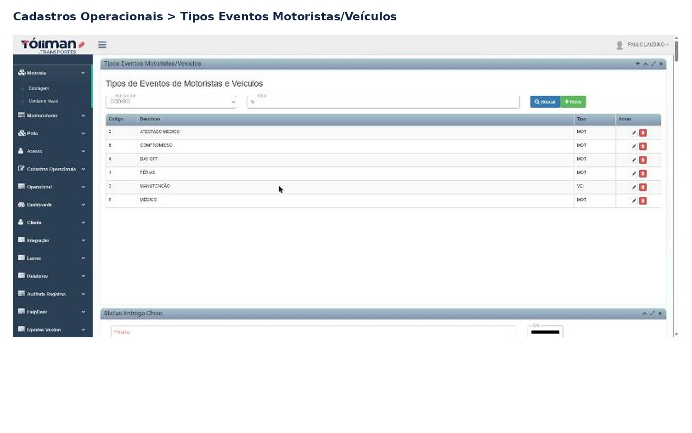

- **Consulta:** Buscar por (Código) + Valor + **Buscar**.
- **+ Novo:** cadastra um tipo de evento.
- **Colunas:** Código, Descrição, Tipo (**MOT** = motorista, **VEI** = veículo) e Ações.
- Exemplos: Atestado Médico, Compromisso, Day Off, Férias, Manutenção (veículo) e Médico.

### 7.6 Tipo Container

Cadastro dos tipos de container. Busca por Nome; use o `+` do cabeçalho para incluir um tipo.

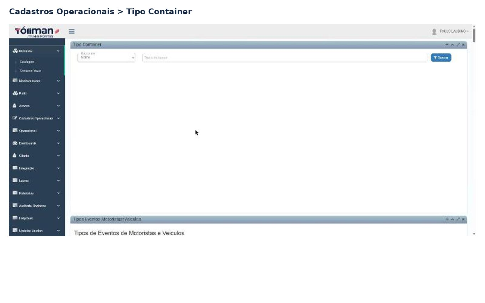

## 8. Operacional

### 8.1 Monitoramento Vistoria

Painel central das vistorias.

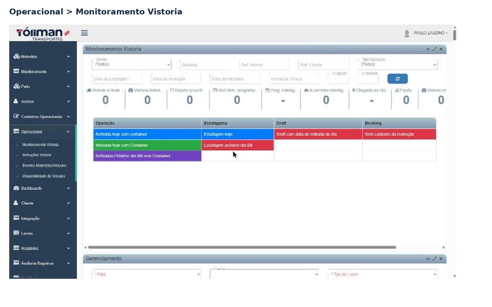

- **Filtros:** Cliente, Booking, Ref. Interna, Ref. Cliente, Tipo Operação, Data da Estufagem, Data da Instrução, Data da Retirada, Motorista/Placa, A Liberar e A Vistoriar.
- **Indicadores:** Vistoria a Realizar, Vistoria Realizada, Depots a confirmar, Mot./Veíc. programado, Prog. estufagem, A caminho estufagem, Chegada ao cliente, Estufado e Vistoria (role a barra horizontal para ver todos).
- **Legenda de cores:**

| Coluna | Cor | Significado |
|---|---|---|
| Operação | Azul | Retirada hoje sem container |
| Operação | Verde | Retirada hoje com container |
| Operação | Roxo | Retiradas do próximo dia útil sem container |
| Estufagem | Azul | Estufagem hoje |
| Estufagem | Vermelho | Estufagem no próximo dia útil |
| Draft | Vermelho | Draft com data de retirada do dia |
| Booking | Vermelho | Sem cadastro da instrução |

### 8.2 Instruções Vistoria

Consulta e cadastro das instruções de vistoria. Busca por Booking; use o `+` do cabeçalho para incluir uma instrução.

### 8.3 Eventos Motoristas/Veículos

Cadastro e acompanhamento dos eventos que afetam a disponibilidade de motoristas e veículos (férias, atestados, manutenção etc.).

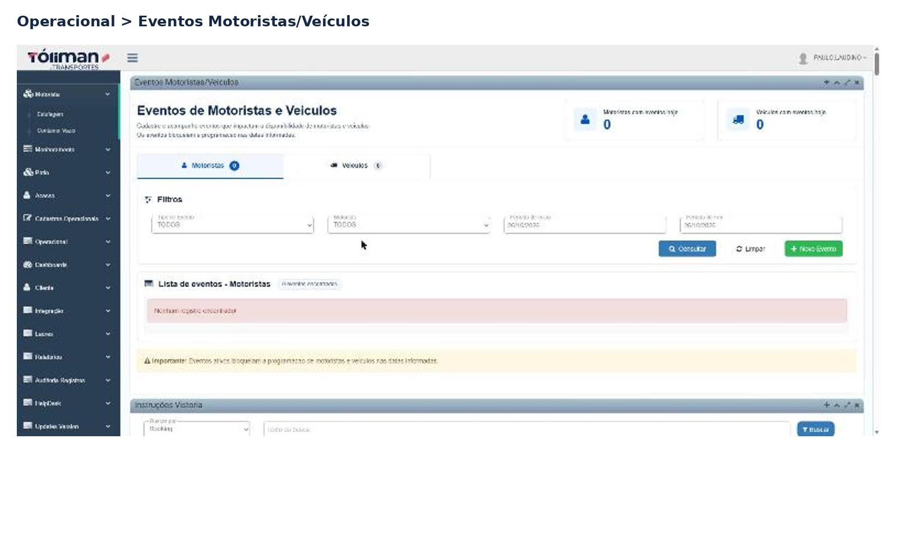

- **Cards no topo:** Motoristas com eventos hoje e Veículos com eventos hoje.
- **Abas:** **Motoristas** e **Veículos**, cada uma com a quantidade de eventos.
- **Filtros:** Tipo de Evento, Motorista, Período de início e Período de fim.
- **Botões:** **Consultar**, **Limpar** e **+ Novo Evento**.

> **Importante:** eventos ativos bloqueiam a programação de motoristas e veículos nas datas informadas.

### 8.4 Disponibilidade de Veículos

Painel de controle para distribuir embarques, considerando motoristas, chegada aos portos de descarga na baixada, tipo de equipamento, eventos e prioridades operacionais.

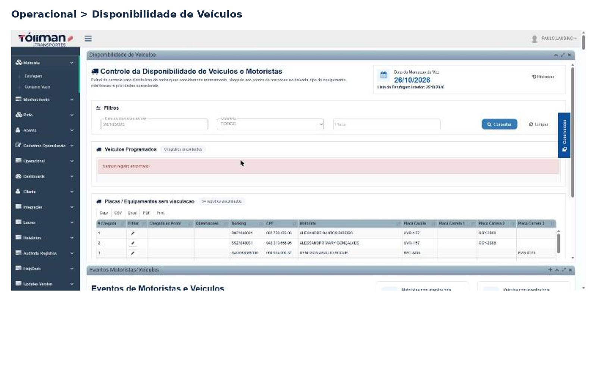

- **Data de Marcação da Vez:** data de referência do painel (com a data limite da estufagem interior). O botão **Histórico** mostra os dias anteriores.
- **Filtros:** Data de Marcação da Vez, Motorista e Placa. Botões **Consultar** e **Limpar**.
- **Veículos Programados:** veículos já programados para a data.
- **Placas / Equipamentos sem vinculação:** fila de chegada com Editar, Chegada no Porto, Observações, Booking, CPF, Motorista e placas (cavalo e carretas). Exporta para Copy, CSV, Excel, PDF e Print.
- **Aba lateral "Ordem veículos":** mostra a ordem dos veículos.

## 9. Dashboards

### 9.1 Tracking Motorista

Mapa com a localização dos motoristas.

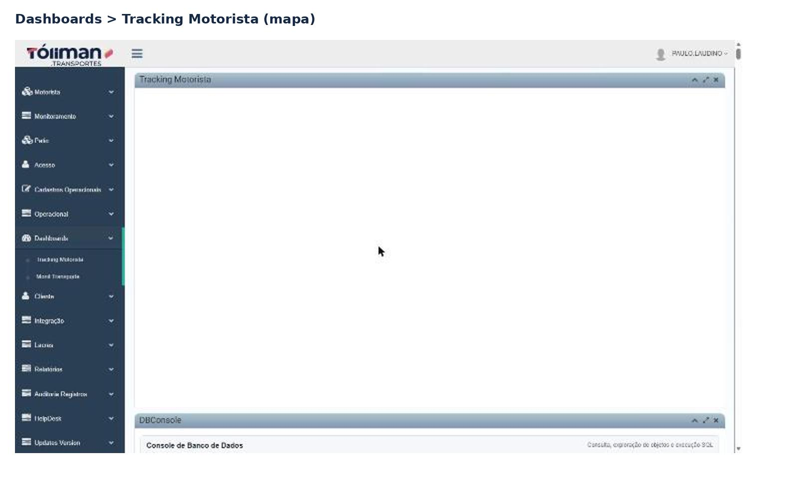

### 9.2 Monit Transporte

Painel de transporte com os mesmos filtros e indicadores de **Operacional > Monitoramento Vistoria**.

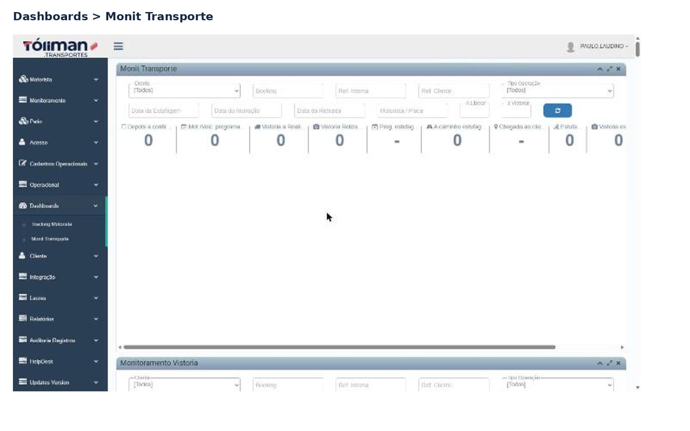

## 10. Cliente

### 10.1 Consulta Online

Consulta integrada de Vistoria, Draft e Ordem de Carregamento, voltada ao cliente.

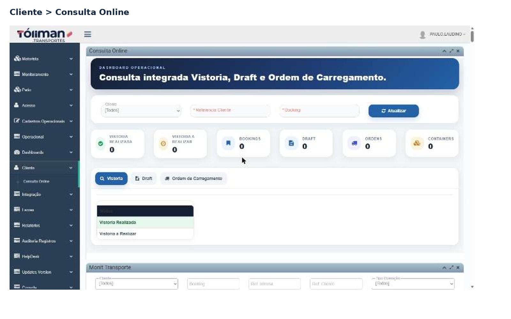

1. Selecione o **Cliente** e informe a **Referência Cliente** ou o **Booking** (obrigatórios).
2. Clique em **Atualizar**.
3. Confira os indicadores: Vistoria Realizada, Vistoria a Realizar, Bookings, Draft, Ordens e Containers.
4. Use as abas **Vistoria**, **Draft** e **Ordem de Carregamento** para ver os detalhes.

## 11. Integração

### 11.1 Integração PRC

Consulta das integrações PRC. Busca por Booking; use o `+` do cabeçalho para incluir um registro.

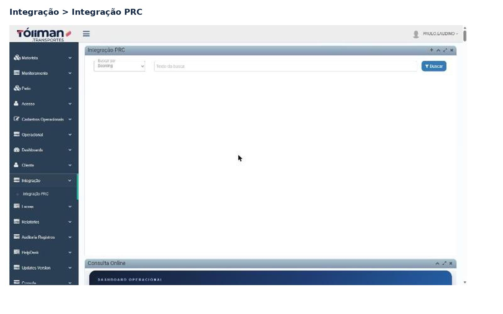

## 12. Lacres

### 12.1 Cadastro Lacres

Cadastro dos lacres. Busca por Tipo de Lacre; use o `+` do cabeçalho para incluir lacres.

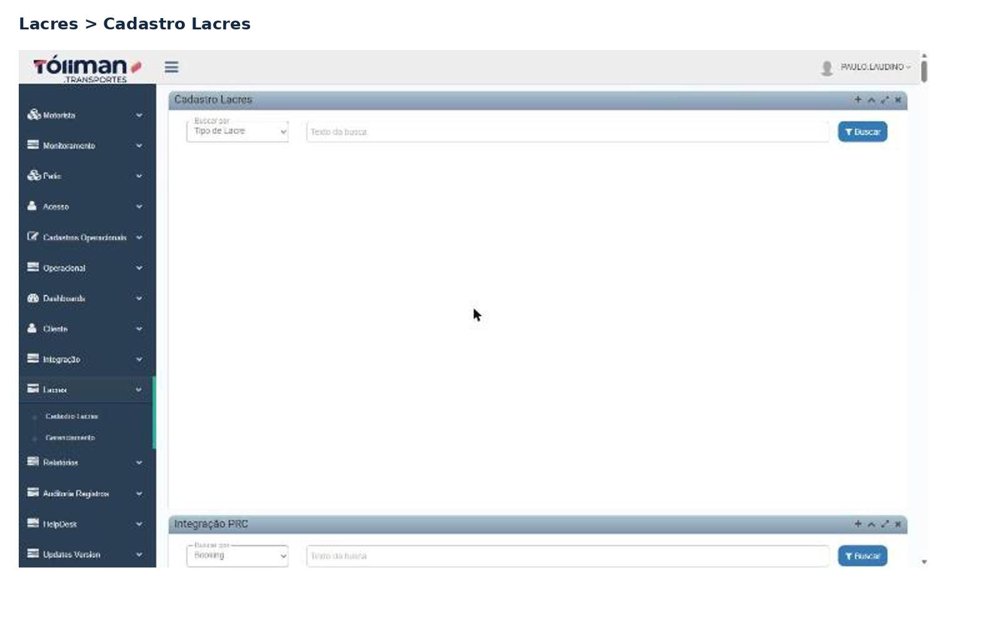

### 12.2 Gerenciamento

Controle do estoque e do uso de lacres.

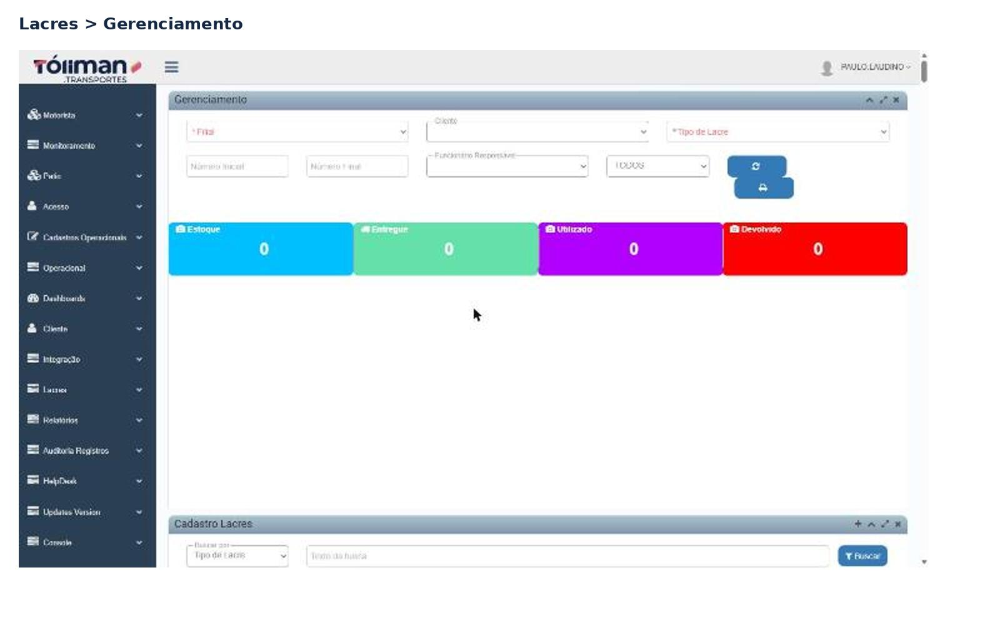

- **Filtros:** Filial (obrigatório), Cliente, Tipo de Lacre (obrigatório), Número Inicial, Número Final, Funcionário Responsável e Situação (Todos).
- **Botões:** ⟳ atualiza e 🖨️ imprime.
- **Indicadores:** **Estoque** (azul), **Entregue** (verde), **Utilizado** (roxo) e **Devolvido** (vermelho).

## 13. Relatórios

### 13.1 Resumo Embarques

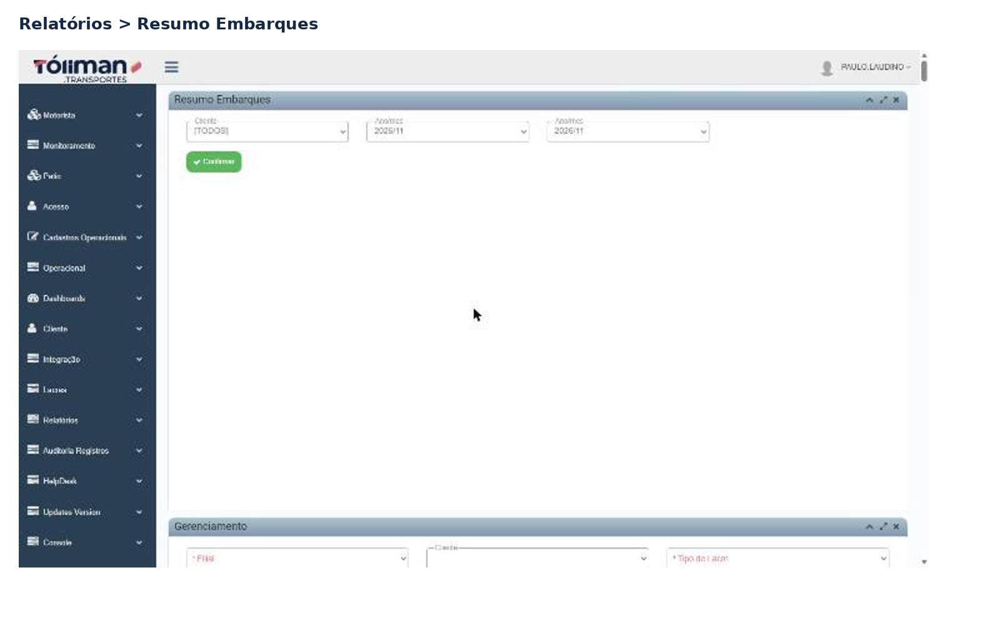

1. Escolha o **Cliente** (ou Todos).
2. Escolha o período inicial e final em **Ano/Mês**.
3. Clique em **Confirmar** para gerar o resumo.

## 14. Auditoria Registros

### 14.1 Auditoria

Consulta das alterações feitas no sistema.

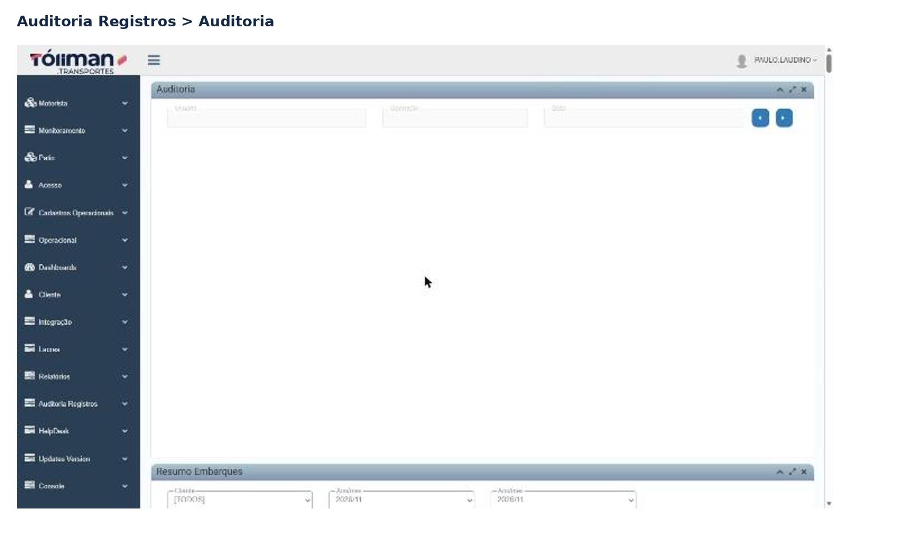

- **Filtros:** Usuário, Operação e Data.
- **Setas ◀ ▶:** navegam entre os registros.

## 15. HelpDesk

### 15.1 Dashboard

Indicadores dos chamados: SLA, horas de resolução e distribuição operacional.

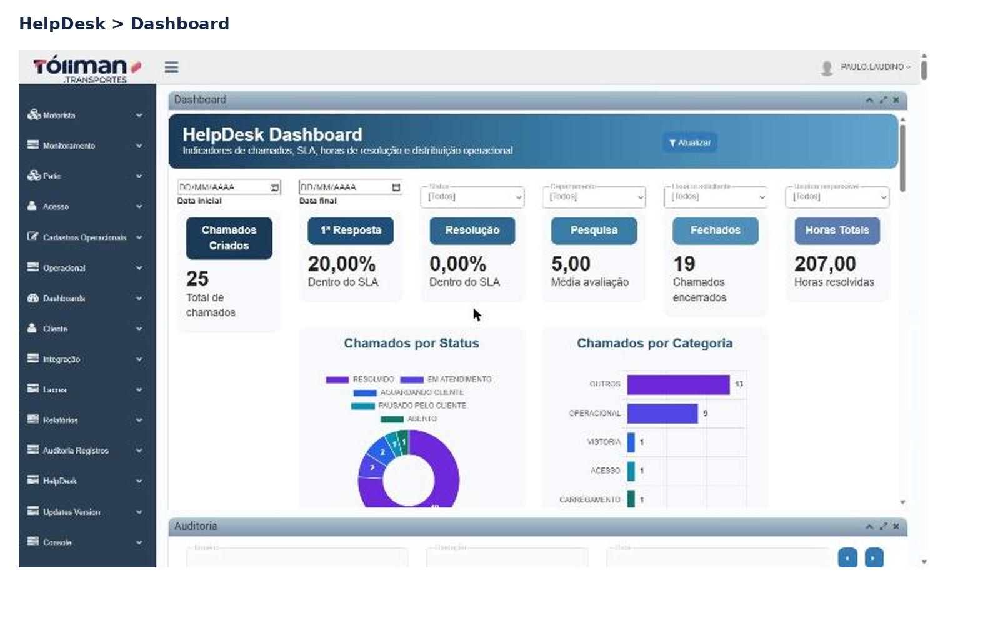

- **Filtros:** Data inicial, Data final, Status, Departamento, Usuário solicitante e Usuário responsável. Clique em **Atualizar** para aplicar.
- **Indicadores:** Chamados Criados, 1ª Resposta (% dentro do SLA), Resolução (% dentro do SLA), Pesquisa (média da avaliação), Fechados e Horas Totais.
- **Gráficos:** Chamados por Status e Chamados por Categoria.

### 15.2 Criação Ticket

Consulta, filtro e gestão dos chamados.

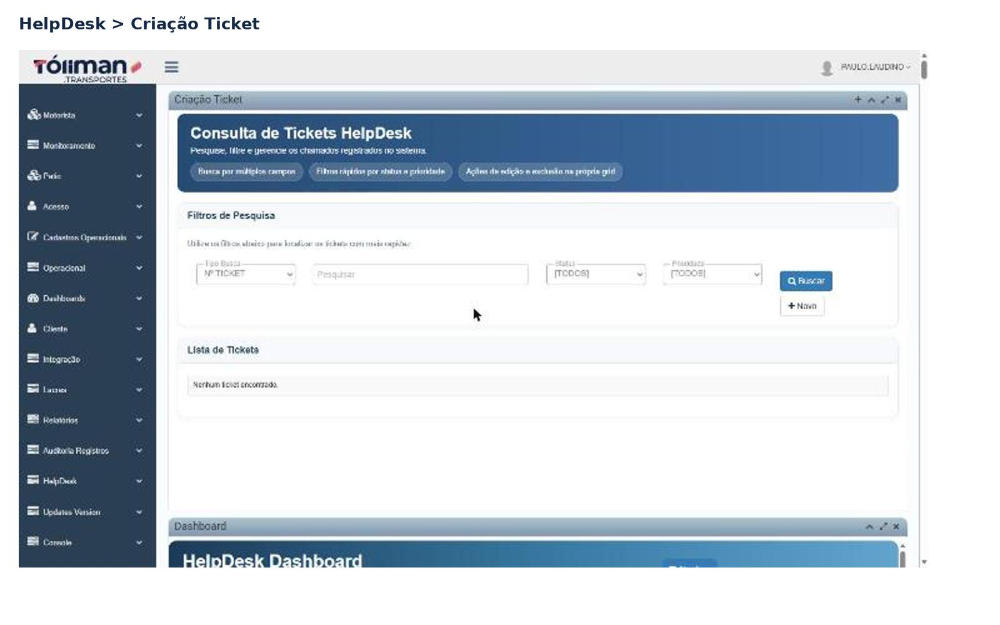

- **Filtros de Pesquisa:** Tipo Busca (por exemplo, Nº Ticket), Pesquisar, Status e Prioridade.
- **Buscar:** lista os tickets em **Lista de Tickets**, onde é possível editar e excluir.
- **+ Novo:** abre um novo chamado.

### 15.3 SLA

Cadastro dos prazos de SLA. Busca por Prioridade; **+ Novo** inclui um SLA.

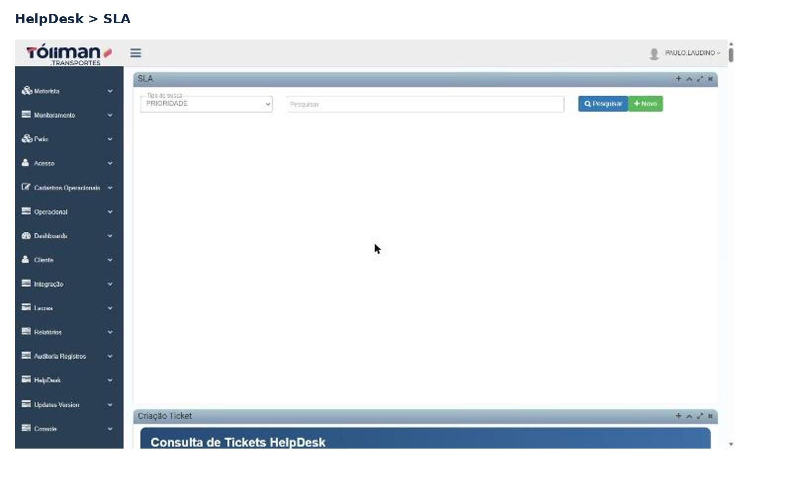

### 15.4 Manual

Deveria mostrar o manual do HelpDesk, mas a página retorna erro. Veja [Problemas conhecidos](#19-problemas-conhecidos).

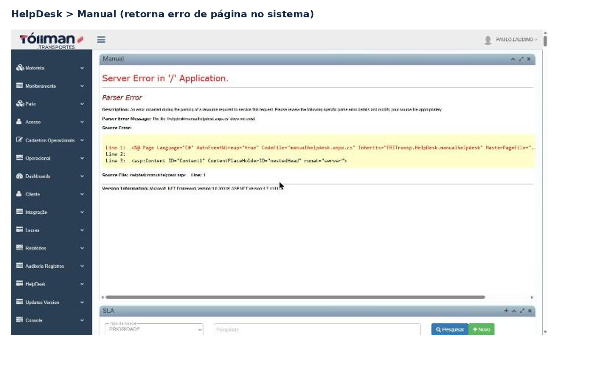

### 15.5 Prioridade

Cadastro das prioridades dos chamados. Busca por Nome; **+ Novo** inclui uma prioridade.

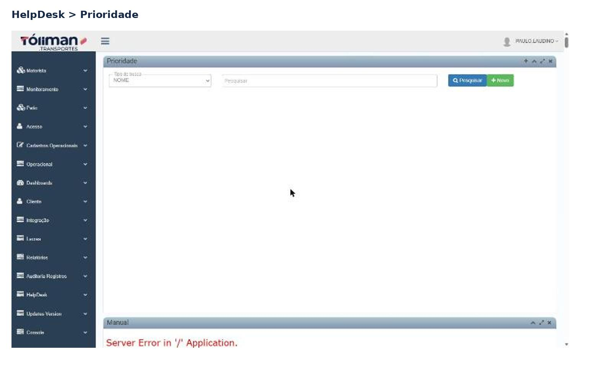

### 15.6 Categoria

Cadastro das categorias dos chamados (por exemplo, Outros, Operacional, Vistoria, Acesso e Carregamento). Busca por Nome; **+ Novo** inclui uma categoria.

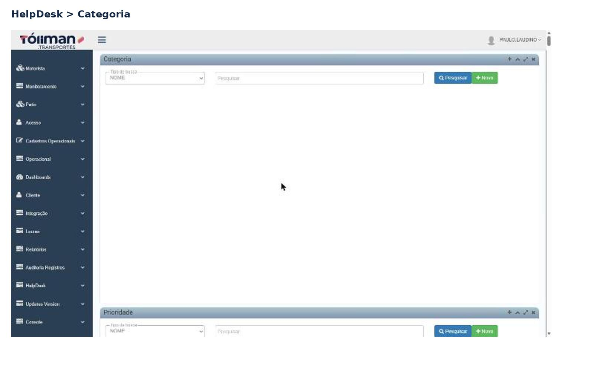

### 15.7 Departamentos

Cadastro dos departamentos. Busca por Código; use o `+` do cabeçalho para incluir um departamento.

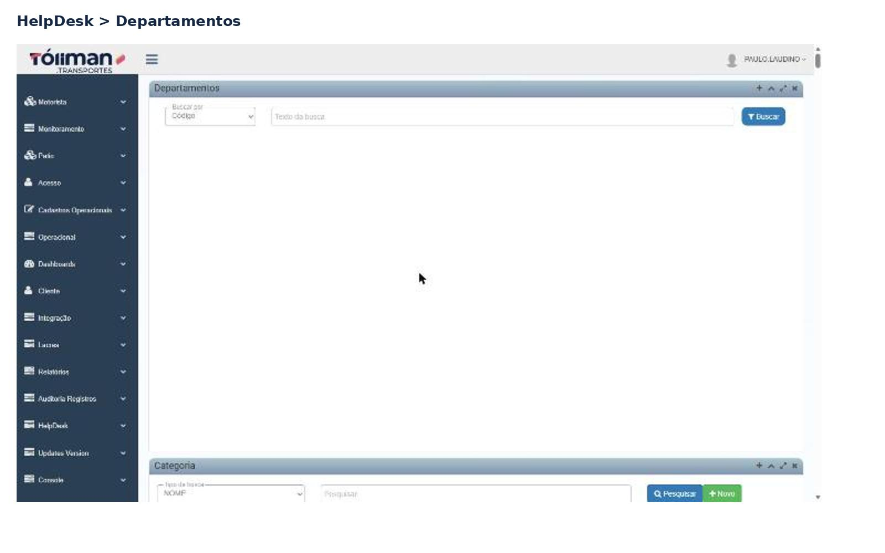

### 15.8 Manual Updates

Manual do sistema de controle de versões e updates, com objetivo, escopo (cadastro de versões e updates, detalhamento das alterações, testes e homologações, aprovações, controle de implantação e evidências) e perfis de acesso.

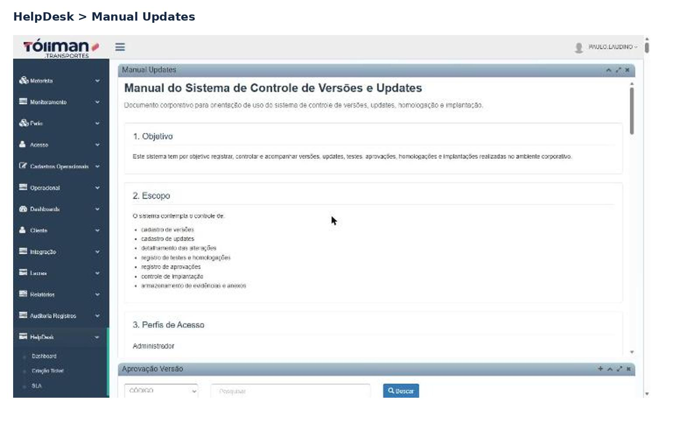

## 16. Updates Version

### 16.1 Cadastro Versão

Registro das versões e updates do sistema. Busca por Código; **+ Novo update** registra um update.

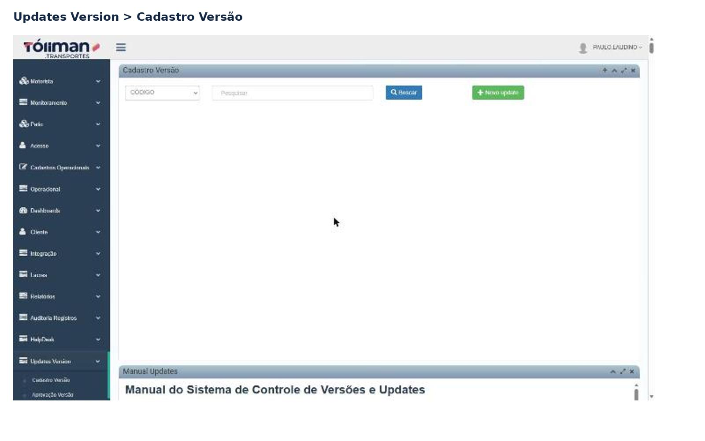

### 16.2 Aprovação Versão

Aprovação das versões cadastradas. Busque por Código e aprove a versão desejada.

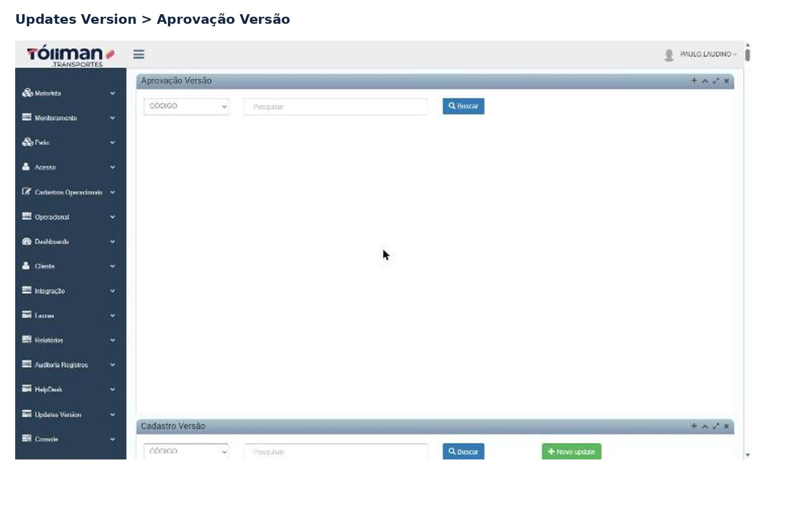

### 16.3 Cadastro de Módulos

Cadastro dos módulos do sistema que recebem versões. Busca por Nome do Módulo; **+ Novo módulo** inclui um módulo.

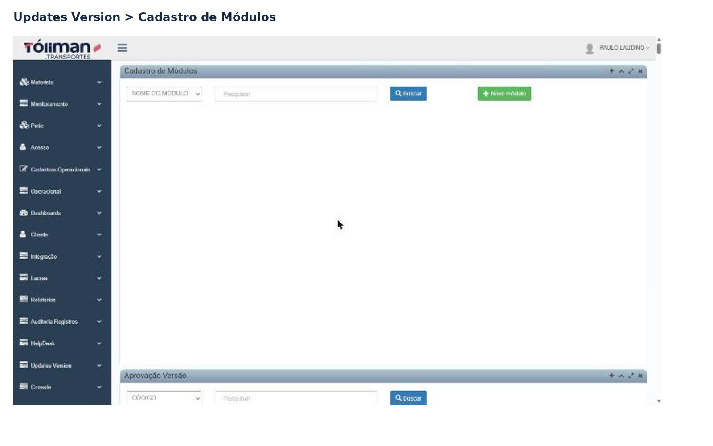

## 17. Console

### 17.1 DBConsole

Console de banco de dados para consulta, exploração de objetos e execução de SQL. Uso restrito à equipe técnica.

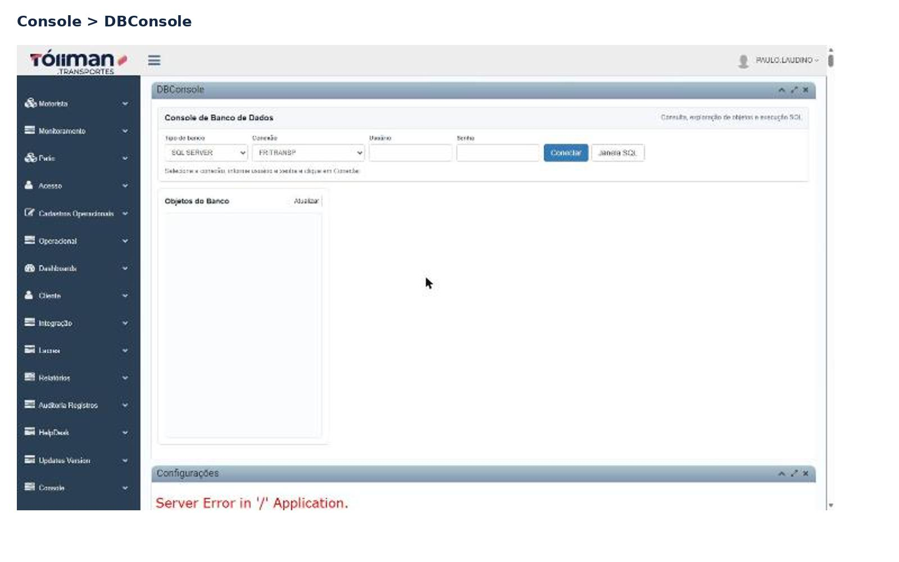

1. Selecione o **Tipo de banco** (por exemplo, SQL Server) e a **Conexão** (por exemplo, FRITRANSP).
2. Informe **Usuário** e **Senha** do banco e clique em **Conectar**.
3. Navegue pelos objetos em **Objetos do Banco** (botão **Atualizar** recarrega a lista).
4. Use **Janela SQL** para executar comandos.

## 18. Configurações

Acessada pelo menu do usuário (canto superior direito). A página retorna erro no momento. Veja [Problemas conhecidos](#19-problemas-conhecidos). Abaixo dela fica o painel **Meus dados**, com o nome e o CPF do usuário.

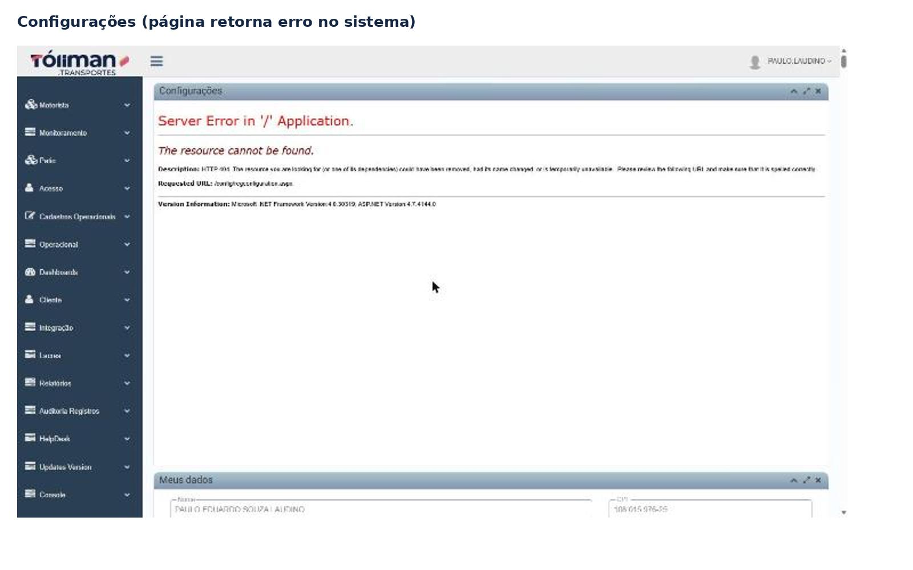

## 19. Problemas conhecidos

| Tela | Erro | Detalhe |
|---|---|---|
| HelpDesk > Manual | Server Error — *Parser Error* | O arquivo `manualhelpdesk.aspx.cs` não existe no servidor. |
| Configurações | Server Error — HTTP 404 *The resource cannot be found* | A página de configurações não foi encontrada no servidor. |

Essas telas devem ser corrigidas pela equipe de desenvolvimento.
